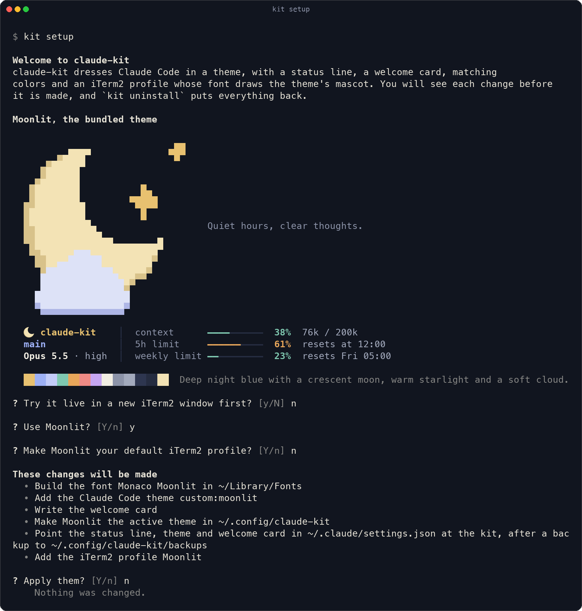
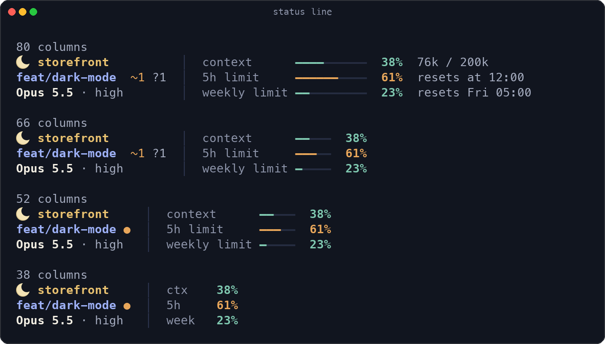
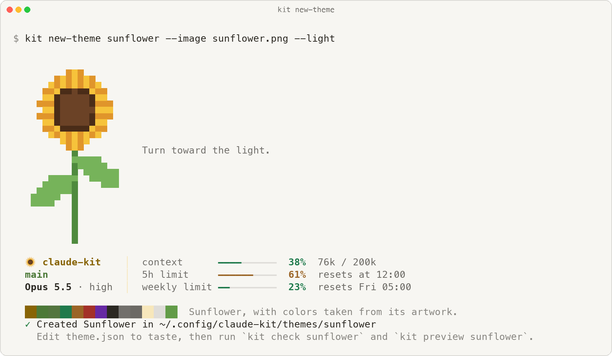

<h1 align="center">claude-kit</h1>

<p align="center">
  Themes, status line widgets and mini apps for <a href="https://docs.claude.com/en/docs/claude-code/overview">Claude Code</a>, set up in one guided command and undone in another.
</p>

<p align="center">
  <a href="https://github.com/brian-rey-development/claude-kit/actions/workflows/check.yml"></a>
  <a href="LICENSE"></a>
  
  
</p>

<p align="center">
  
</p>

A theme gives Claude Code a look of its own. It brings a status line that fits any terminal width, a welcome card above the prompt, matching Claude Code colors, and an iTerm2 profile whose font draws the theme's mascot as a single character. Every theme is a folder of plain data, so you can make one from a photo in a minute, and every part of the kit is documented well enough for an AI agent to extend it for you.

## Install

```bash
git clone https://github.com/brian-rey-development/claude-kit ~/.claude-kit
~/.claude-kit/install.sh
```

The setup checks your Mac first, then draws the theme right in your terminal, offers a live preview in a new iTerm2 window, and lists every change before it makes one. Nothing is written until you say yes.

<p align="center">
  
</p>

It needs macOS, [Claude Code](https://docs.claude.com/en/docs/claude-code/setup) and `jq`, which ships with macOS 15 and installs elsewhere with `brew install jq`. [iTerm2](https://iterm2.com) is optional, because the status line and the welcome card work in any terminal, and only the colors and the mascot font need it.

To undo everything, run `kit uninstall`. The kit records what your settings held before the first install, so uninstall puts back exactly that and removes every file the kit added.

## What you get

**A status line that always fits.** It shows the repository, branch and pull request, the model and its effort level, and three meters for context, the 5-hour limit and the weekly limit. A limit meter turns to the danger color and says when the limit will run out if your current pace would reach it before the reset. As the terminal narrows, the least important details step down first, so the rows stay aligned at every width.

<p align="center">
  
</p>

**A welcome card** with the theme's art and tagline, shown above the prompt until your first message. It is a small Claude Code mod, and it picks the largest of three sizes that fits the window.

**Matching colors** for Claude Code, for its subagent panel and for iTerm2, all derived from one palette that `kit check` holds to WCAG AA contrast.

**A mascot in your font.** The kit builds a copy of Monaco on your Mac whose icon character draws the theme's mascot, in full color where the terminal supports it, so the status line can open with a crescent moon or a sunflower instead of an emoji.

## Make it yours

`kit new-theme` turns any picture into a complete theme. It takes the hues from the image, pushes their lightness until every text color is readable on the background, draws the card art in three sizes and builds the glyph, so the result passes its own checks before you touch it.

<p align="center">
  
  &nbsp;&nbsp;&nbsp;
  
</p>

| You want to | Run or read |
| --- | --- |
| Turn a photo or drawing into a theme | `kit new-theme forest --image ~/Pictures/forest.png`, then the [first theme tutorial](docs/tutorials/first-theme.md) |
| Rearrange the status line | `kit widgets`, then `kit layout "location,context" "git,limit_5h" "model,clock"` |
| Write a new widget | [Add a widget](docs/how-to/add-a-widget.md), one small jq file |
| Build a mini app inside Claude Code | [Write a mod](docs/how-to/write-a-mod.md) |
| Fix a color that fails contrast | [Tune a palette](docs/how-to/tune-a-palette.md) |

## Built for AI agents

Ask Claude Code to "make me a theme from this photo" or "add a widget that shows the time in Tokyo" inside this repository, and it has what it needs. [AGENTS.md](AGENTS.md) maps the code and the rules, [llms.txt](llms.txt) indexes the docs, and [.claude/skills](.claude/skills) holds a step-by-step skill for each common task, namely a new theme, a new widget and a new mod. Every command an agent needs runs without questions, `kit apply --dry-run` lists changes before they happen, `kit doctor` exits non-zero with a fix on each failing line, and output drops its colors when it is not going to a terminal.

## Commands

| Command | What it does |
| --- | --- |
| `kit setup` | Pick, preview and apply a theme, one step at a time |
| `kit themes` | List the themes and their colors |
| `kit preview <theme>` | Open the theme in a new iTerm2 window without changing your setup, or draw it here with `--here` |
| `kit apply <theme>` | Apply without questions, for scripts and agents, with `--dry-run` to list the changes first |
| `kit doctor` | Check that everything is in place, with a fix for each problem |
| `kit new-theme <id> --image <file>` | Make a theme from an image |
| `kit check <theme>` | Validate a theme against the schema and the contrast rules |
| `kit widgets`, `kit layout` | List the status line widgets, and choose which ones show |
| `kit uninstall` | Undo every change |

Every option is in the [CLI reference](docs/reference/cli.md).

## How it works

```text
themes/moonlit/            theme.json, claude.json, art.json, glyph/icon.png
        │
        ▼  kit apply
~/.claude/settings.json    status line command, custom:moonlit theme, welcome mod
~/.claude/themes/          the Claude Code color theme
~/Library/Fonts/           Monaco Moonlit, with the mascot in its icon character
iTerm2 dynamic profile     colors and font, inheriting everything else from your profile
```

The status line is a Bash script that makes one `jq` pass over the session data Claude Code sends, with git and pull request details cached in the background so nothing waits on the network. Each widget is a jq function that offers a few versions of itself from widest to narrowest, and a small layout engine picks the richest set that fits the width. The [explanation](docs/explanation/how-it-works.md) covers the pipeline, the font glyph and the iTerm2 profile in depth, and [files.md](docs/reference/files.md) lists every path the kit writes.

## Documentation

- Tutorial, [make your first theme](docs/tutorials/first-theme.md)
- How-to guides for [adding a widget](docs/how-to/add-a-widget.md), [writing a mod](docs/how-to/write-a-mod.md) and [tuning a palette](docs/how-to/tune-a-palette.md)
- Reference for the [CLI](docs/reference/cli.md), the [theme format](docs/reference/theme-format.md), the [widget contract](docs/reference/widgets.md) and [every file the kit writes](docs/reference/files.md)
- [How it works](docs/explanation/how-it-works.md)

## Contributing

Contributions are welcome, and [CONTRIBUTING.md](CONTRIBUTING.md) covers the setup and the checks. `make check` runs ruff, pyright in strict mode, the test suite, shellcheck and the mod tests, and CI runs the same target on macOS. The screenshots on this page are drawn from real kit output by `make screenshots`.

## Licensing

The code is under the [MIT license](LICENSE), and the bundled Moonlit art and the sunflower drawing are CC0. Monaco belongs to Apple, so the kit never ships the font. It builds a patched copy on your Mac from the Monaco your Mac already has, and the repository refuses to commit any `.ttf`. If you build a theme from art you did not make, keep it in `~/.config/claude-kit/themes/` and do not publish it.
