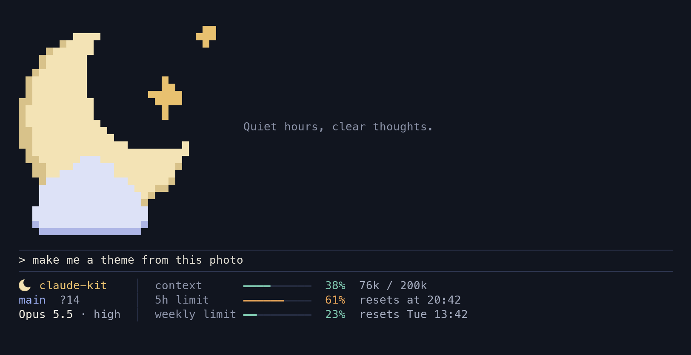

# claude-kit

Give Claude Code a look of its own. A theme brings a status line that fits any terminal width, a welcome card above the prompt, matching Claude Code colors, and an iTerm2 profile whose font draws the theme's mascot as a single character.



## Install

```bash
git clone https://github.com/brian-rey-development/claude-kit ~/.claude-kit
~/.claude-kit/install.sh
```

The guided setup checks your Mac, shows each theme in your terminal, offers a live preview in a new iTerm2 window, and lists every change before it makes one. It needs macOS, [Claude Code](https://docs.claude.com/en/docs/claude-code/setup) and `jq` (included since macOS 15, otherwise `brew install jq`). [iTerm2](https://iterm2.com) is optional, since the status line and the welcome card work in any terminal.

To undo everything, run `kit uninstall`. It puts back what your settings held before the first install and removes every file the kit added.

## What you get

**A status line** with your repository, branch and pull request, the model, and three meters for context, the 5-hour limit and the weekly limit. The limit meters switch to the danger color and say when a limit will run out if your current pace would get there before it resets. When the terminal narrows, the least important details step down first, so the rows always fit and always line up.

**A welcome card** with the theme's art and tagline, shown above the prompt until your first message. It picks the largest of three sizes that fits.

**Matching colors** for Claude Code itself, for its subagent panel, and for iTerm2, all from one palette that meets WCAG AA contrast.

**A mascot in your font.** The kit builds a copy of Monaco whose icon character draws the theme's mascot, in color where the terminal supports it.

## Make it yours

| You want to | Run or read |
| --- | --- |
| Turn a photo or drawing into a theme | `kit new-theme forest --image ~/Pictures/forest.png`, then the [first theme tutorial](docs/tutorials/first-theme.md) |
| Rearrange the status line | `kit widgets`, then `kit layout "location,context" "git,limit_5h" "model,clock"` |
| Write a new widget | [Add a widget](docs/how-to/add-a-widget.md) |
| Build a mini app inside Claude Code | [Write a mod](docs/how-to/write-a-mod.md) |
| Let an AI agent do any of the above | Point it at [AGENTS.md](AGENTS.md); the repository ships skills for each task |

## Commands

| Command | What it does |
| --- | --- |
| `kit setup` | Pick, preview and apply a theme, one step at a time |
| `kit themes` | List the themes and their colors |
| `kit preview <theme>` | Open the theme in a new iTerm2 window without changing your setup; `--here` draws it in this terminal |
| `kit apply <theme>` | Apply without questions, for scripts and agents; `--dry-run` lists the changes first |
| `kit doctor` | Check that everything is in place, with a fix for each problem |
| `kit new-theme <id> --image <file>` | Make a theme from an image |
| `kit widgets`, `kit layout` | List the status line widgets, and choose which ones show |
| `kit uninstall` | Undo every change |

The full list, with every option, is in the [CLI reference](docs/reference/cli.md).

## Documentation

- [Make your first theme](docs/tutorials/first-theme.md)
- How-to guides for [adding a widget](docs/how-to/add-a-widget.md), [writing a mod](docs/how-to/write-a-mod.md) and [tuning a palette](docs/how-to/tune-a-palette.md)
- Reference for the [CLI](docs/reference/cli.md), the [theme format](docs/reference/theme-format.md), the [widget contract](docs/reference/widgets.md) and [every file the kit writes](docs/reference/files.md)
- [How it works](docs/explanation/how-it-works.md), for the status line pipeline, the font glyph and the iTerm2 profile

## Licensing

The code is under the [MIT license](LICENSE), and the bundled Moonlit art is CC0. Monaco belongs to Apple, so the kit never ships the font. It builds a patched copy on your Mac from the Monaco your Mac already has, and the repository refuses to commit any `.ttf`. If you build a theme from art you did not make, keep it in `~/.config/claude-kit/themes/` and do not publish it.
